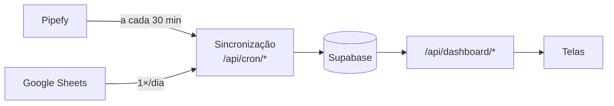

# Documentação do Dashboard Comercial Fluxo

## Por onde começar

Se você acabou de chegar ao projeto, leia nesta ordem:

1. **[arquitetura.md](arquitetura.md)**: o desenho geral, em 10 minutos.
2. **[dados.md](dados.md)**: o vocabulário (gestão, ciclo, coordenação, etapas
   do funil) e de onde vem cada número.
3. **[pendencias.md](pendencias.md)**: o que está em risco agora.
4. **[operacao.md](operacao.md)**: os procedimentos que você vai precisar
   primeiro, principalmente a **virada de gestão** e o **congelamento de períodos**.

Depois, consulte conforme a necessidade:

| Documento | Quando usar |
|---|---|
| [estrutura.md](estrutura.md) | Para achar onde está cada coisa no código |
| [automacoes.md](automacoes.md) | Quando uma sincronização falhar ou um segredo precisar ser trocado |
| [decisoes.md](decisoes.md) | Antes de "simplificar" algo que parece estranho |
| Repositório privado de arquivo | Histórico completo do git, o plano e o contexto originais do projeto e o registro da passagem de responsabilidade. Fica fora deste repositório porque contém dados reais |

## Resumo em uma página

- **Agendador:** `pg_cron` no Supabase (principal) e GitHub Actions (reserva).
- **Regra de ouro:** as telas leem só o banco; nunca chamam Pipefy ou Sheets.
- **Nada some em silêncio:** cada carga e cada linha rejeitada ficam registradas
  e aparecem na tela de Auditoria.
- **Período fechado tem memória:** depois de congelado, o número reportado não
  muda se a planilha for corrigida.
- **Datas em horário de Brasília.** A gestão vai de 1º de outubro a 30 de setembro.

## Mantendo esta documentação

- Ao mudar um comportamento, atualize o documento correspondente **no mesmo PR**.
- Decisão nova ou revertida: registre em [decisoes.md](decisoes.md) com o motivo.
- Pendência resolvida: tire de [pendencias.md](pendencias.md).
- Os diagramas são Mermaid e aparecem renderizados no GitHub.
