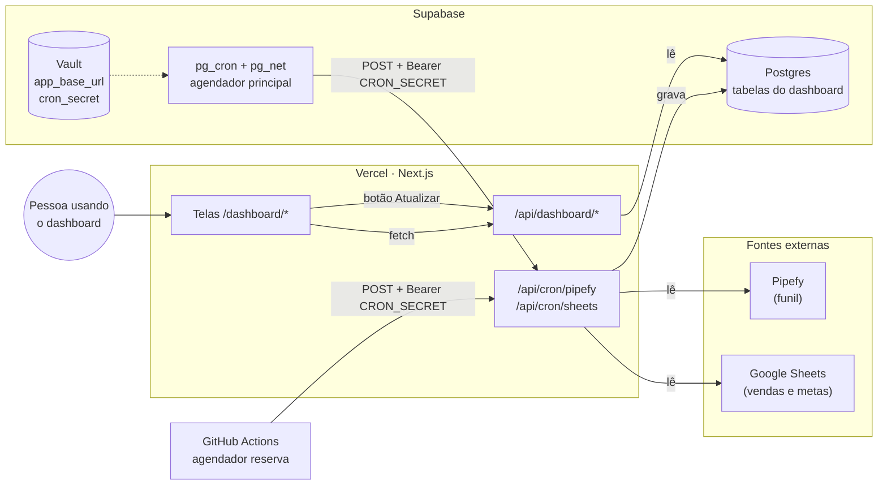
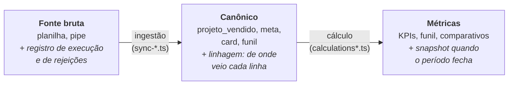
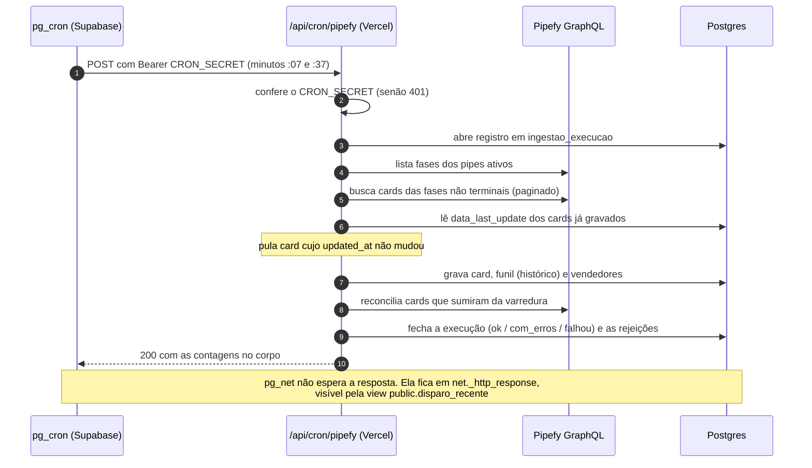
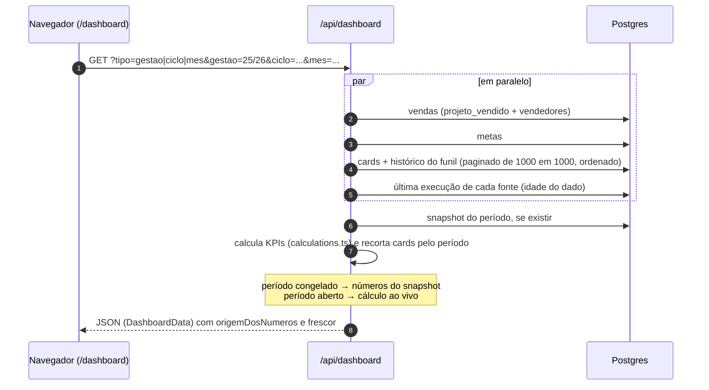
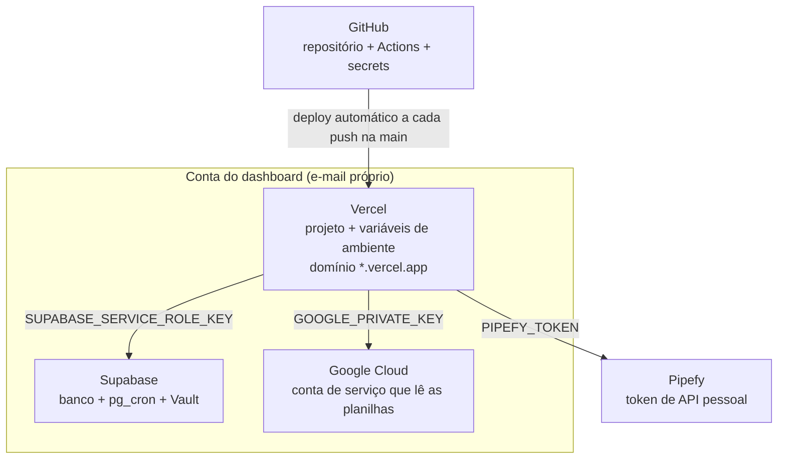

# Arquitetura

Como as peças do Dashboard Comercial Fluxo se encaixam: de onde vem cada número,
por onde ele passa e quem dispara cada etapa.

## Visão geral

O dashboard é uma aplicação **Next.js** hospedada na **Vercel** que lê tudo de um
banco **Supabase (Postgres)**. O banco é abastecido por duas fontes externas:

- **Pipefy**: o CRM, de onde vem o **funil** (cards, fases e histórico de fases).
- **Google Sheets**: as planilhas oficiais de cada gestão, de onde vêm **vendas**
  (contratos assinados) e **metas**.

### A regra que organiza tudo

**As telas nunca falam com o Pipefy nem com o Google Sheets.** Toda leitura vem
do banco. Só as rotas de sincronização (e o botão Atualizar) vão às fontes.

Isso existe por três motivos, todos vividos em produção:

1. A cota de leitura do Google Sheets é por minuto: quando a tela lia a planilha
   a cada acesso, poucas pessoas navegando ao mesmo tempo já derrubavam o
   dashboard (17% das requisições voltavam HTTP 500 num teste).
2. Sem o banco no meio não há como guardar "o que um período fechou"
   (snapshots), nem registrar o que foi descartado na leitura (auditoria).
3. Uma fonte fora do ar não derruba a tela: ela continua mostrando o último dado
   carregado, com a idade dele à vista.

## As três camadas do dado

| Camada                 | Onde vive                                                             | O que garante                                                                                                                                                              |
| ---------------------- | --------------------------------------------------------------------- | -------------------------------------------------------------------------------------------------------------------------------------------------------------------------- |
| Fonte bruta → canônico | `src/lib/sync-pipefy.ts`, `src/lib/sync-sheets.ts`, `src/lib/fontes/` | Nenhum descarte silencioso: toda linha que não vira dado grava um motivo em `ingestao_rejeicao`. Cada linha gravada aponta para a célula ou card de origem (`origem_ref`). |
| Canônico → métricas    | `src/lib/calculations.ts`, `src/lib/calculations-funil.ts`            | Funções puras, sem rede, cobertas por testes. A mesma regra serve à tela e ao congelamento.                                                                                |
| Métricas congeladas    | `src/lib/snapshots/`, tabela `snapshot_periodo`                       | Período fechado tem memória: corrigir a planilha depois não muda, em silêncio, um número já reportado.                                                                     |

## Fluxo de ingestão (sincronização)

O agendador principal é o `pg_cron`, **dentro do Supabase**. Ele chama as rotas
de sincronização da Vercel por HTTP (`pg_net`), com o `CRON_SECRET` guardado no
Vault. O GitHub Actions faz o mesmo, com frequência bem menor, como reserva.

A sincronização das planilhas segue o mesmo desenho (`/api/cron/sheets`, a cada
15 min entre 07h e 21h): lê a aba **Contratos** pelo nome dos cabeçalhos, lê a aba **Metas por
coordenação** como blocos, grava `projeto_vendido` e `meta` e apaga o que sumiu
da planilha **só na gestão que acabou de ser lida** (e nunca quando a leitura
volta vazia).

| Disparo        | Quem                                                  | Frequência                                                         | Escopo                                                                 |
| -------------- | ----------------------------------------------------- | ------------------------------------------------------------------ | ---------------------------------------------------------------------- |
| Principal      | `pg_cron` no Supabase                                 | Pipefy `7,37 * * * *` · Planilhas `4,19,34,49 10-23 * * *` (15 em 15 min, 07–21h em Brasília) | Pipes ativos, fases não terminais, só cards alterados · Gestão vigente |
| Reserva        | GitHub Actions (`.github/workflows/cron.yml`)         | Pipefy a cada 6 h · Planilhas 1×/dia às 15:47 UTC                  | Igual ao principal                                                     |
| Manual         | Botão **Atualizar** → `POST /api/dashboard/atualizar` | Sob demanda, com trava de 60 s                                     | Igual ao principal, sem segredo                                        |
| Carga completa | `scripts/backfill-*.ts`, à mão                        | Quando precisa reparar                                             | Todos os pipes e todas as gestões                                      |

Detalhes, segredos e diagnóstico de falha: [automacoes.md](automacoes.md).

## Fluxo de leitura (uma tela abrindo)

Cada tela chama a rota da sua área:

| Tela                                        | Rotas                                                                                                          |
| ------------------------------------------- | -------------------------------------------------------------------------------------------------------------- |
| `/dashboard` (Visão geral)                  | `/api/dashboard`, `/api/dashboard/funil`                                                                       |
| `/dashboard/funil`                          | `/api/dashboard`, `/api/dashboard/funil`, `/api/dashboard/comparador-fases`, `/api/dashboard/comparador-funil` |
| `/dashboard/vendedores`, `/dashboard/metas` | `/api/dashboard`                                                                                               |
| `/dashboard/auditoria`                      | `/api/dashboard/auditoria`, `/api/dashboard/origem` (via "Conferir um número")                                 |
| `/tv` (painel de parede, sem seletor)       | `/api/tv`, a cada 5 min: metas e faturamento, funil e fechados do ciclo vigente, ranking da gestão e histórico, últimas entregas                       |
| Todas                                       | `POST /api/dashboard/atualizar` (botão Atualizar)                                                              |

**Tudo segue o seletor de período** do topo da tela. As exceções são o
Comparador periódico de funil, que por definição escolhe dois períodos próprios,
e o painel `/tv`, que mostra sempre a gestão e o ciclo vigentes.

### Cache das respostas

As rotas de leitura (`/api/dashboard`, `/funil`, `/comparador-fases`,
`/comparador-funil` e `/origem`) guardam a **resposta pronta** de cada combinação
de parâmetros (`src/lib/cache.ts`). A primeira abertura de um período lê o banco
(~1 s); as seguintes saem do cache (dezenas de milissegundos).

- **Invalidação:** toda sincronização descarta o cache ao terminar, inclusive
  com erro: `/api/cron/pipefy`, `/api/cron/sheets` e o botão Atualizar. O botão
  invalida **sempre**, mesmo quando o cooldown impede a carga.
- **Validade máxima de 30 min**, para o que escreve no banco por fora do Next
  (scripts de backfill e de congelamento) e para valores que dependem da data.
- **A idade do dado fica fora do cache**, medida a cada requisição.
- **Leitura vazia não é guardada:** se o banco falhar, a rota responde 503 e a
  tela mostra erro, em vez de zeros guardados por meia hora.
- A Auditoria (`/api/dashboard/auditoria`) **não** tem cache: é diagnóstico e
  precisa mostrar o estado de agora.

## Infraestrutura e contas

| Serviço      | Papel                                                                     | Observação                                                        |
| ------------ | ------------------------------------------------------------------------- | ----------------------------------------------------------------- |
| GitHub       | Código, agendador reserva (Actions), secrets `VERCEL_URL` e `CRON_SECRET` | Push na `main` publica em produção; outras branches geram preview |
| Vercel       | Hospeda telas e rotas; guarda as variáveis de ambiente                    | Plano Hobby — ver [pendencias.md](pendencias.md). Funções em **`pdx1`** (Portland), mesma região do banco |
| Supabase     | Banco, agendador principal (`pg_cron`), segredos do agendador (Vault)     | Região **`us-west-2`** (Oregon). RLS ligado; o servidor usa a `service_role`, que ignora RLS |
| Google Cloud | Conta de serviço com acesso de leitura às planilhas                       | As planilhas precisam estar compartilhadas com o e-mail dela      |
| Pipefy       | Token de API usado na sincronização do funil                              | Token pessoal: depende do acesso de quem o gerou                  |

Nenhuma credencial chega ao navegador: não existe variável `NEXT_PUBLIC_*`, e
todas as rotas que falam com o banco rodam no servidor.

## Stack

| Parte       | Tecnologia                                                                                 | Atenção                                                                                                                                                            |
| ----------- | ------------------------------------------------------------------------------------------ | ------------------------------------------------------------------------------------------------------------------------------------------------------------------ |
| Framework   | Next.js 16 (App Router, Turbopack)                                                         | Versão com mudanças incompatíveis em relação ao que muita gente (e muita IA) conhece. Antes de mexer em convenção do framework, ler `node_modules/next/dist/docs/` |
| UI          | React 19, Tailwind 4, componentes shadcn (`src/components/ui/`), Recharts 3, `next-themes` | shadcn usa o pacote único `radix-ui`; o CLI `shadcn` só é necessário para adicionar componentes                                                                    |
| Banco       | Supabase (Postgres) com `pg_cron`, `pg_net` e Vault                                        | Migrations em `supabase/migrations/`, aplicadas à mão no SQL Editor                                                                                                |
| Integrações | `googleapis` (Sheets, somente leitura), `fetch` na API GraphQL do Pipefy                   |                                                                                                                                                                    |
| Qualidade   | TypeScript, ESLint, Vitest, Knip                                                           | `npm run typecheck`, `npm run lint`, `npm test`, `npm run knip`                                                                                                    |

Próximo passo para entender o código: [estrutura.md](estrutura.md).
