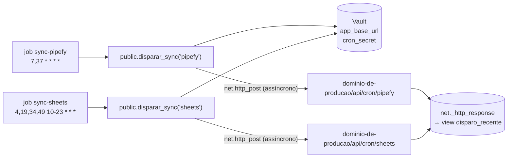

# Automações, conexões e segredos

Quem dispara cada sincronização, onde está cada credencial e como descobrir o
que falhou.

## Os quatro jeitos de sincronizar

| | Agendador principal | Agendador reserva | Botão Atualizar | Backfill |
|---|---|---|---|---|
| **Onde** | `pg_cron` no Supabase | GitHub Actions (`.github/workflows/cron.yml`) | Telas → `POST /api/dashboard/atualizar` | `scripts/backfill-*.ts`, na máquina de alguém |
| **Pipefy** | `7,37 * * * *` (a cada 30 min) | `13 */6 * * *` (a cada 6 h) | sob demanda | à mão |
| **Planilhas** | `4,19,34,49 10-23 * * *` (15 em 15 min, 07–21h Brasília) | `47 15 * * *` (12:47 Brasília) | sob demanda | à mão |
| **Autenticação** | `CRON_SECRET` do Vault | `CRON_SECRET` do GitHub | nenhuma (trava por cooldown) | credenciais do `.env.local` |
| **Escopo Pipefy** | pipes ativos, fases não terminais, só cards alterados | igual | igual | todos os pipes, todas as fases, reescrita forçada (~40 min) |
| **Escopo planilhas** | gestão vigente | igual | igual | todas as gestões do registry |
| **Aparece em `ingestao_execucao` como** | `cron` | `cron` | `manual` | `backfill` |

Horários do cron em UTC. Os minutos fogem do início da hora de propósito: é o
horário em que os agendadores compartilhados mais atrasam.

## Agendador principal: `pg_cron` no Supabase

Configurado pelas migrations `0007` a `0009`.



- `disparar_sync(alvo)` monta a URL com o segredo `app_base_url` do Vault (só o
  domínio, sem caminho e sem barra no fim) e envia `Authorization: Bearer
  <cron_secret>`.
- `pg_net` **não espera a resposta**. O job aparece como sucesso mesmo se a rota
  devolver erro. A resposta fica em `net._http_response`, exposta pela view
  `public.disparo_recente` (só a `service_role` lê).
- `pg_net` **não segue redirecionamento**: uma URL com barra sobrando gera 3xx e
  nada sincroniza. Por isso a função normaliza a URL.

Consultas úteis (SQL Editor do Supabase):

```sql
-- agendamentos ativos
select jobid, jobname, schedule, active from cron.job;

-- para onde o disparo vai (sem disparar)
select public.url_do_disparo('pipefy');

-- disparar agora e ver a resposta (espere ~15 s entre os dois)
select public.disparar_sync('pipefy');
select id, status_code, error_msg, corpo from public.disparo_recente limit 5;

-- histórico do agendador ("sucesso" aqui só quer dizer que a chamada saiu)
select jobid, status, start_time, return_message
  from cron.job_run_details order by start_time desc limit 20;

-- pausar sem apagar / reagendar
select cron.unschedule('sync-pipefy');
select cron.schedule('sync-pipefy', '7,37 * * * *', $$select public.disparar_sync('pipefy')$$);
```

## Agendador reserva: GitHub Actions

Workflow **Sincronização de Dados** (`.github/workflows/cron.yml`):

- Chama as mesmas rotas com os secrets `VERCEL_URL` (domínio de produção, no
  formato `https://dominio`, sem barra no fim) e `CRON_SECRET` do repositório.
  O workflow normaliza a URL, mas o formato certo evita surpresa.
- Falha o job se a rota devolver HTTP diferente de 200 **ou** `"ok":false` no
  corpo (rodada com erro de gravação).
- Pode ser disparado à mão: **Actions → Sincronização de Dados → Run workflow**,
  escolhendo `pipefy`, `sheets` ou `ambos`.

**Por que só a cada 6 horas.** Uma reserva frequente esconderia a queda do
agendador principal: o dado continuaria "fresco" e ninguém perceberia que o
`pg_cron` parou. Com 6 h contra um limite de frescor de 3 h, se o `pg_cron` cair
o alarme dispara mesmo assim. Além disso, a auditoria confere o agendador
principal em separado, por `disparo_recente` (que só o `pg_net` alimenta).

O agendamento do GitHub também é pouco confiável: em agosto de 2026, com
`*/30`, 64% das execuções nunca aconteceram. Foi o motivo da mudança para o
`pg_cron`.

## Botão Atualizar

`POST /api/dashboard/atualizar` roda as duas sincronizações (Pipefy e planilhas)
na hora, do navegador, sem segredo. A proteção é a trava em
`src/lib/ingestao/disparo-manual.ts`:

- se a última execução da fonte terminou há menos de **60 s**, não dispara;
- se há uma execução em andamento há menos de **5 min**, não dispara (depois
  disso ela é considerada pendurada e liberada);
- nunca varre fases terminais nem força reescrita.

Uma rodada típica leva cerca de 10 s. Ao final, o botão **sempre** descarta o
cache das telas (`src/lib/cache.ts`), inclusive quando o cooldown impediu a
carga — é também o jeito de ver na hora o que um script gravou no banco.

## Onde está cada segredo

| Segredo | Vercel (env) | `.env.local` | GitHub secrets | Supabase Vault | Para que serve |
|---|---|---|---|---|---|
| `SUPABASE_URL` | ✅ | ✅ | | | Endereço do banco |
| `SUPABASE_SERVICE_ROLE_KEY` | ✅ | ✅ | | | Acesso total ao banco (ignora RLS). Só no servidor |
| `PIPEFY_TOKEN` | ✅ | ✅ | | | API do Pipefy |
| `GOOGLE_SERVICE_ACCOUNT_EMAIL` | ✅ | ✅ | | | Conta de serviço que lê as planilhas |
| `GOOGLE_PRIVATE_KEY` | ✅ | ✅ | | | Chave dessa conta (aceita `\n` literal) |
| `CRON_SECRET` | ✅ | ✅ | ✅ `CRON_SECRET` | ✅ `cron_secret` | Autentica os agendadores. **Os quatro precisam ser iguais** |
| URL de produção | | | ✅ `VERCEL_URL` | ✅ `app_base_url` | Para onde os agendadores chamam. **Nunca no código**: o repositório é público |
| `PIPEFY_PIPE_ID` | | opcional | | | Só para `scripts/inspecionar-pipe.ts` |

Mudou uma variável na Vercel? **Faça um redeploy**: ela só vale em deploy novo.
Como trocar cada um com segurança: [operacao.md](operacao.md#trocar-um-segredo).

## Como saber se está funcionando

| Onde olhar | O que mostra |
|---|---|
| Cabeçalho de toda tela (`IdadeDoDado`) | Há quanto tempo a fonte mais atrasada foi lida. Fica em alerta acima de **3 h** (Pipefy) ou **30 h** (planilhas) |
| Tela **Auditoria** | Última carga de cada fonte, rejeições com motivo, cobertura, snapshots, agendador principal parado há mais de 3 h |
| `ingestao_execucao` | Cada carga: status, contagens, quem disparou, erro |
| `ingestao_rejeicao` | Cada linha ou card que não virou dado, com motivo legível e payload |
| `disparo_recente` | Resposta HTTP de cada disparo do `pg_cron` |
| Actions do GitHub | Log das rodadas da reserva, com o corpo da resposta |
| Logs da Vercel | `console.log` das rotas (`[SyncPipefy]`, `[Cron Sheets]` …) |

## Diagnóstico

| Sintoma | Causa provável | O que fazer |
|---|---|---|
| `disparo_recente` com **401** | `cron_secret` do Vault ≠ `CRON_SECRET` da Vercel | Igualar os dois (e o do GitHub) |
| `disparo_recente` com **404** | `app_base_url` aponta para o lugar errado (preview, deploy específico, caminho junto) | `select public.url_do_disparo('pipefy')` e corrigir no Vault |
| `disparo_recente` com **3xx** | URL com barra ou espaço sobrando | Corrigir `app_base_url` |
| `error_msg` preenchido | A chamada nem saiu (DNS, timeout, worker parado) | `select net.worker_restart();` |
| Nada aparece em `disparo_recente` | Worker do `pg_net` parado ou job desativado | `select * from cron.job;` e `net.worker_restart()` |
| 200 com `"ok": false` | Erro de gravação no banco | Ver `ingestao_execucao.erro` e o corpo da resposta |
| 504 `FUNCTION_INVOCATION_TIMEOUT` | Rodada cresceu além de 300 s | Descobrir por que cresceu (varredura completa?) antes de subir o limite |
| Execução `falhou` nas planilhas com erro de coluna | Cabeçalho renomeado ou removido na planilha | Corrigir a planilha ou o registry |
| Aviso "não há fonte cadastrada para a gestão vigente" | Virada de gestão sem planilha nova no registry | [Virada de gestão](operacao.md#virada-de-gestão) |
| Rejeição "fase ausente do MapaPipe" | Fase nova ou renomeada no Pipefy | Atualizar `src/lib/fontes/pipes.ts` |
| Tela não mostra o que um script acabou de gravar | O cache das telas só é descartado por sincronizações do Next; scripts rodam por fora | Clicar em **Atualizar** (ou esperar até 30 min) |
| Tela com erro "O banco não respondeu agora" (503) | Uma leitura do banco voltou vazia — quase sempre falha momentânea | Recarregar; se persistir, ver o status do Supabase |
