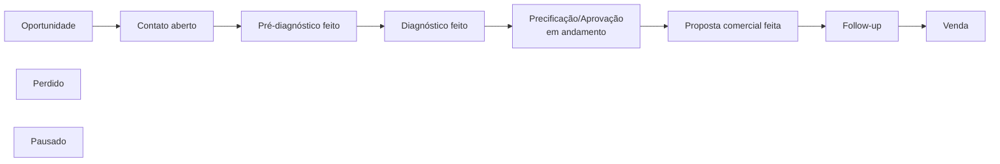
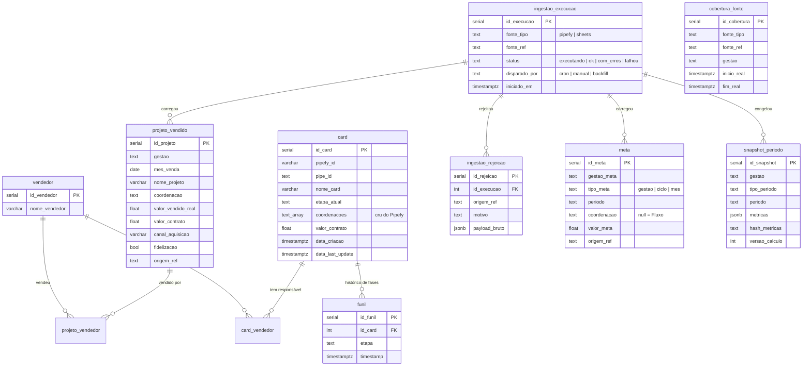

# Dados: domínio, fontes e banco

O que cada termo significa, de onde cada dado vem e como fica guardado.

## Domínio

### Gestão

O ano fiscal da Fluxo vai de **1º de outubro a 30 de setembro**. O rótulo `"25/26"`
é a gestão de 01/10/2025 a 30/09/2026.

- A **gestão vigente** sai da data (`idGestaoVigente` em `src/lib/fontes/registry.ts`).
  Em 01/10 ela avança sozinha, sem editar código.
- Uma gestão só aparece na tela se estiver **cadastrada no registry**. Enquanto a
  vigente não tiver planilha cadastrada, telas e cron usam a mais recente que
  tiver, e o cron avisa na resposta. Para cadastrar uma gestão nova, ver
  [operacao.md](operacao.md#virada-de-gestão).
- Hoje o registry tem **23/24, 24/25, 25/26 e 26/27**.

### Ciclo

Subdivisão da gestão, com **nome e duração definidos por cada gestão**. Não são
trimestres:

| Gestão | Ciclos |
|---|---|
| 23/24 | Fuji (out–jan), Andes (fev–mai), Everest (jun–set) |
| 24/25 | Waterloo (out–jan), Stalingrado (fev–mai), Normandia (jun–set) |
| 25/26 | Revolução do Fogo (out–dez), Revolução da Forja (jan–mar), Era Industrial (abr–jun), Apollo (jul–set) |
| 26/27 | Gambito (out–dez), Ciclo 2 (jan–mar), Ciclo 3 (abr–jun), Ciclo 4 (jul–set). Os nomes dos ciclos 2 a 4 ainda são provisórios |

Os ciclos são declarados no registry (e não lidos da planilha) e validados ao
carregar: precisam ser contíguos e cobrir os 12 meses (`fontes/calendario.ts`).

### Coordenações

`CCE`, `ACE`, `MNP`, `QAB` e `PRO` (lista única em `src/lib/coordenacoes.ts`).

- No Pipefy o campo é texto livre e aparece com outros valores (`NP`, `AN`,
  `N2`, `CONTRATO`, `PAUSADO`, IDs internos). O banco guarda o que a fonte disse
  (`card.coordenacoes`, cru); quem filtra é a leitura (`ehCoordenacao`).
- Um card pode pertencer a mais de uma coordenação (**cross-sell**). Ele conta em
  cada uma, e por isso a soma das coordenações pode passar do total.

### Etapas do funil

Oito etapas comerciais, nesta ordem, mais duas terminais fora da ordem:

| Etapa | Significado (definição do dono do processo) |
|---|---|
| Oportunidade | Onde todo lead chega, ainda sem contato. **Todos os cards passam por aqui** — é a base (100%) do funil |
| Contato aberto | Houve uma tentativa de contato, não necessariamente bem-sucedida |
| Pré-diagnóstico feito | Lead qualificado; pode aguardar a reunião de diagnóstico |
| Diagnóstico feito … Follow-up | Avanço comercial até a proposta e o acompanhamento |
| Venda | Fechou |
| Perdido, Pausado | Terminais; não entram na conversão |

Três números diferentes saem do funil, e todos seguem o período escolhido:

| Número | Pergunta que responde |
|---|---|
| Quantidade por fase | Dos cards criados no período, onde eles estão **agora**? |
| Conversão | Dos cards criados no período, quantos **passaram** por cada etapa (sobre Oportunidade)? |
| Tempo no funil | Quanto tempo os cards do período ficaram em cada fase? |

Por isso os números da tela **não batem com o board do Pipefy**: o board mostra
todo card aberto, de qualquer época; a tela mostra a safra do período.

### Metas

Cada nível tem **meta própria**, e elas não são somadas nem derivadas entre si:

| Nível | Meta da Fluxo | Meta por coordenação |
|---|---|---|
| Gestão | sim | sim (em 24/25, derivada: soma das metas de ciclo) |
| Ciclo | sim | sim |
| Mês | sim | **não existe** |

Faltando a meta de um nível, a tela mostra "sem meta definida", e não usa a de
outro nível nem mostra 0%. A soma das metas das coordenações não reconstrói a
meta da Fluxo; a tela de Auditoria mostra essa diferença de propósito.

### Pessoas

O banco guarda o responsável como a planilha escreveu: apelido em 23/24 e 24/25
("Jonas"), nome completo em 25/26 e 26/27 ("Jonas Pimenta Thé"). `pessoa_grafia`
liga cada grafia a uma pessoa, e `buscarVendasDoBanco` troca a grafia pelo
`nome_exibicao` na leitura — ranking, `/dashboard/vendedores`, snapshots e TV
herdam a unificação.

- Grafia sem pessoa continua sendo ela mesma; a Auditoria lista quais são.
- A grafia é gravada normalizada (`normalizarNomeVendedor`): palavras
  capitalizadas, um espaço entre elas. Editando à mão, use a forma que a
  Auditoria mostra.
- A busca tenta `(grafia, gestão do contrato)` antes de `(grafia, nula)`.
- Montar ou revisar a base: [operacao.md](operacao.md#base-de-pessoas).

### Valor de venda

O total vendido usa a coluna **"Valor Vendido real"** (o que de fato entrou), e
não "Valor contrato". As duas existem nas planilhas e divergem.

O ranking por vendedor e por canal (cada responsável leva o valor inteiro do
contrato) usa "Valor contrato" de 24/25 em diante e **"Valor Vendido real" até
23/24**, onde "Valor contrato" não é o valor do projeto
(`valorDoResponsavel` em `src/lib/calculations.ts`).

---

## Fontes

### Google Sheets — uma planilha por gestão

Os IDs ficam em `src/lib/fontes/registry.ts`. Não são segredo: o acesso depende
do compartilhamento com o e-mail da conta de serviço (`GOOGLE_SERVICE_ACCOUNT_EMAIL`).

**Aba `Contratos`** — uma linha por contrato assinado. Lida pelo **nome do
cabeçalho**, nunca pela posição (exceção: a coluna do mês, que não tem cabeçalho
utilizável). Coluna renomeada ou removida faz a leitura falhar com o nome dela.

| Campo canônico | Cabeçalho na planilha | Obrigatório |
|---|---|---|
| `mes` | coluna A (sem cabeçalho) | sim |
| `projeto` | Projetos Assinados | sim |
| `coordenacao` | Coordenação | sim |
| `responsavel1..4` | Responsável 1..4 | |
| `valorVendidoReal` | Valor Vendido real | |
| `valorContrato` | Valor contrato | |
| `canalAquisicao` | Canal de aquisição | |
| `fidelizacao` | Fidelização? (só 25/26) | |
| `assinado`, `contratante`, `itemDaCarta`, `prazo`, `dataAssinatura`, `dataEntrega`, `precoPorSemana`, `numeroParcelas`, `compiladoNoPortal` | nomes equivalentes | |

Linha sem campo obrigatório é descartada **com motivo** em `ingestao_rejeicao`.
Linha sem valor entra com zero.

**Aba `Metas por coordenação`** — não é uma tabela, é um painel com blocos
espalhados (lido por `fontes/blocos.ts`):

- bloco **METAS** (coluna B): metas mensais da Fluxo, encerrado pela linha
  `total`, que é a meta da gestão;
- bloco **GESTÃO** (coluna B, só 25/26): meta de gestão por coordenação;
- blocos **Ciclo ...** (coluna E): meta do ciclo por coordenação e da Fluxo, com
  `FIM:` e a data na mesma linha. O ciclo é casado pela **data FIM**, não pelo
  nome, porque os nomes só são revelados ao longo da gestão ("Ciclo XXX").

Cada planilha tem diferenças de layout. Elas estão comentadas em `observacoes` de
cada gestão no registry.

### Google Sheets — faturamento (26/27 em diante)

Planilha separada, "Fluxo Faturado por Mês 26/27" (`faturamento` da gestão no
registry). A aba "Visão Geral" (Fluxo) e as abas ACE, CCE, MNP, PRO e QAB têm a
mesma grade: uma linha de meses ("Outubro/26"), embaixo "Previsto | Realizado",
embaixo os valores. O ano vem da gestão, não do rótulo. A aba "Metas por
coordenação" usa o layout de blocos da planilha de vendas. Leitor:
`src/lib/fontes/faturamento.ts`. A conta de serviço precisa estar compartilhada
como Leitor nessa planilha também.

### Google Sheets — projetos (entregas)

`FONTE_ENTREGAS` no registry: abas "Projetos - Entregues" e "Projetos - Atual"
da planilha de projetos, que cobrem todas as gestões. Leitor:
`src/lib/fontes/entregas.ts`, que documenta duas armadilhas da aba de entregues
(coordenação fora da coluna do cabeçalho e linhas de ACE deslocadas duas
colunas). A data da entrega é o "Prazo Real" ("Prazo Final" é calculado pela
planilha) ou, sem ele, "Data de finalização". A gestão da entrega sai da DATA:
"Gestão - Entrega" é gravada crua, mas a fórmula dela não é confiável e a TV
não a usa. Entrega sem data ou com data no futuro não aparece. A planilha não
tem "no prazo" confiável para todas as entregas, e a TV não mostra.

### Pipefy — dois pipes

Declarados em `src/lib/fontes/pipes.ts`.

| Pipe | ID | Período | Situação |
|---|---|---|---|
| CRM Fluxo | `303819426` | 18/12/2023 a 27/06/2025 | Encerrado. Só o backfill lê. **Não tem** as etapas "Contato aberto" e "Precificação/Aprovação" |
| CRM COM | `306460930` | desde 30/06/2025 | Em uso. Tem as 8 etapas (fases numeradas "1. Oportunidade" … "7. Follow-up", "Venda") |

Os dois não se sobrepõem no tempo e são simplesmente concatenados no banco.

Campos lidos de cada card: **Coordenação**, **Responsável** (no pipe antigo,
"Vendedor Responsável"), **Valor da proposta** e **Canal de aquisição** (com
emoji no pipe antigo). Os nomes de fase e de campo de cada pipe estão no
`MapaPipe` dele.

### Cobertura

`src/lib/fontes/cobertura.ts` declara a janela em que cada fonte era o sistema de
registro. Serve para a tela distinguir **"não medido"** de **"medido e deu zero"**
(por exemplo: não existe funil antes de 18/12/2023). A tabela `cobertura_fonte` é
uma cópia consultável dessa declaração.

---

## Banco (Supabase / Postgres)

### Tabelas

| Tabela | O que guarda | Escrita por | Chave de negócio |
|---|---|---|---|
| `projeto_vendido` | Contratos assinados (vendas). Desde a 0012 também `contratante`, `data_assinatura` e `item_da_carta`, opcionais | `sync-sheets.ts` | `(gestao, nome_projeto, coordenacao, mes_venda)` |
| `pessoa` | Uma linha por pessoa, com `nome_exibicao` curto (único) para tela e `foto_url` opcional (pódio e entregas da TV; sem foto, iniciais). As fotos ficam no bucket público `fotos` do Storage, em `pessoas/<id_pessoa>.webp` (320 px), tiradas do organograma no Miro | à mão / `scripts/sugerir-pessoas.ts` | `nome_exibicao` |
| `pessoa_grafia` | Grafia de responsável → pessoa. `gestao` nula = vale sempre | à mão / `scripts/sugerir-pessoas.ts` | `(grafia, gestao)`, NULLS NOT DISTINCT |
| `meta` | Metas por gestão, ciclo e mês, geral ou por coordenação | `sync-sheets.ts` | `(gestao_meta, tipo_meta, periodo, coordenacao)` |
| `faturamento_mes` | Faturamento previsto e realizado por mês, da Fluxo (`coordenacao` nula) e por coordenação. Valor ilegível grava NULL e motivo em `ingestao_rejeicao` | `sync-sheets.ts` (planilha "Fluxo Faturado por Mês", 26/27 em diante) | `(gestao, coordenacao, mes)`, NULLS NOT DISTINCT |
| `meta_faturamento` | Metas de faturamento, mesmas colunas de `meta`. Mensais (só da Fluxo) e de ciclo (Fluxo e coordenações). A de gestão não é gravada: o "total" do bloco mensal soma só os meses já definidos | `sync-sheets.ts` | `(gestao_meta, tipo_meta, periodo, coordenacao)` |
| `projeto_entrega` | Projetos entregues (`estado = entregue`) e em execução (`em_execucao`), com gestão da venda, "Gestão - Entrega" crua (não usada), data de entrega, tamanho da equipe, `equipe` (nomes de gerente e consultores, ligados a `pessoa` na leitura) e `situacao` crua ("Rescindido" fica no banco; a TV não conta como entrega) | `sync-sheets.ts` (planilha de projetos, todas as gestões de uma vez) | `(estado, coordenacao, nome_projeto, gestao_venda)`, NULLS NOT DISTINCT |
| `vendedor` | Nomes de vendedores (normalizados) | as duas sincronizações | `nome_vendedor` |
| `projeto_vendedor`, `card_vendedor` | Quem vendeu cada contrato / é responsável por cada card | as duas sincronizações | pares de IDs |
| `card` | Cards do Pipefy, com a fase atual | `sync-pipefy.ts` | `pipefy_id` |
| `funil` | Histórico de passagem por fase de cada card | `sync-pipefy.ts` | — (reescrito por card) |
| `ingestao_execucao` | Uma linha por carga, com contagens e status | `ingestao/registro.ts` | — |
| `ingestao_rejeicao` | Cada linha ou card que não virou dado, com motivo e payload | `ingestao/registro.ts` | — |
| `cobertura_fonte` | Cópia da declaração de cobertura | `ingestao/cobertura.ts` | `(fonte_tipo, fonte_ref, gestao)` |
| `snapshot_periodo` | Métricas congeladas de período fechado. **Append-only** (gatilho recusa UPDATE) | `snapshots/congelar.ts` | `(gestao, tipo_periodo, periodo, escopo, versao_calculo)` |

Objetos de agendamento (detalhes em [automacoes.md](automacoes.md)):
`public.disparar_sync(alvo)`, `public.url_do_disparo(alvo)`,
`public.segredo_do_vault(nome)` e a view `public.disparo_recente`.

### Linhagem

Toda venda e toda meta aponta para a origem em `origem_ref`, no formato
`<spreadsheetId>#<aba>#L<linha>`, e para a carga que a gravou (`id_execucao`). A
meta derivada de 24/25 é marcada como `derivado: soma das metas de ciclo`. Rejeições
de card usam `<pipeId>#<cardId>`. É isso que alimenta o "Conferir um número" da
tela de Auditoria.

### Snapshots (períodos congelados)

Um período fechado pode ser **congelado**: as métricas de venda (total, número,
ticket, meta, por coordenação, canal, vendedor e mês) são gravadas em
`snapshot_periodo` com um hash.

- A partir daí a tela mostra o congelado e um selo. Se a planilha mudar depois,
  aparece o aviso **"divergente da fonte"**, mas o número reportado não muda.
- Funil, LTV e comparativos entre gestões **continuam ao vivo**: descrevem o board
  de agora, não o que foi vendido no período.
- Um período só pode ser congelado **depois que o mês seguinte ao fim dele acaba**
  (carência para contratos lançados com atraso).
- `VERSAO_CALCULO` (`snapshots/metricas.ts`) sobe quando uma regra de cálculo
  muda. Com a mesma versão, recalcular tem de dar o mesmo resultado.
- **O congelamento não é automático**: alguém precisa rodar o script (ver
  [operacao.md](operacao.md#congelar-períodos-fechados)).

### Particularidades do schema

- **Paginação obrigatória.** O Supabase devolve no máximo 1.000 linhas por
  consulta. Toda leitura de tabela grande pagina com `.range()` **e ordena pela
  chave primária** — sem ordenar, linhas se repetem ou somem entre páginas.
- **Fuso.** Todas as datas são `timestamptz`, e todo recorte de período é feito em
  horário de Brasília (UTC−3), não no fuso do servidor (a Vercel roda em UTC).
- **`0001_baseline.sql` foi escrita à mão.** Ela não recria RLS, grants nem
  sequences; num banco novo, conferir esses itens no painel.
- **Migrations são aplicadas à mão**, em ordem, no SQL Editor do Supabase. Não há
  CLI nem pipeline de migração.
